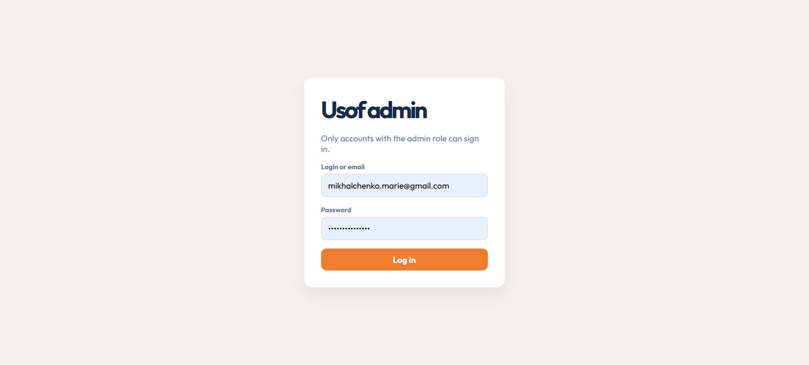

# Usof Forum

Usof Forum is a full-stack question-and-answer project for developers. It includes a REST API and administration panel, along with a React client structure for the forum interface.

## Project structure

- `api/` — Node.js and Express API, MySQL database setup, and administration panel.
- `web/` — React application built with JavaScript, JSX, and Create React App (CRA).
- `.env` — local configuration shared by the API and web application; create it from `.env.example`.
- `package.json` — the only dependency manifest, at the repository root, for both applications.

## Features

The API provides routes for authentication, users, posts, categories, comments, likes, favorites, subscriptions, and notifications. It also includes role-based access checks, file uploads, database initialization, sample data, and an administration panel at `/admin`.

The web application has a shared layout, routes for login, sign-up, email-confirmation instructions, the main page, profile, and notifications, and feature-based Redux Toolkit and RTK Query modules. Login accepts either a username or an email address. After registration, users are directed to the email-confirmation instructions page. The shared header reads the signed-in user's login, role, and avatar from Redux, links to the profile, and logs out through the API. The profile page loads the signed-in user's private profile from `GET /api/users/:user_id` with the access token. The main feed reads the posts array and pagination metadata from the API response.

CRA expects a `package.json` inside its application directory. To keep the repository to one package manifest, `npm run dev:web` and `npm run build:web` generate the minimal CRA metadata file temporarily and remove it when the command exits. Install dependencies only from the repository root.

## Screenshots

The following screenshots show the administration panel and an example API response.




## Requirements

- Node.js 22.2 or newer
- npm
- MySQL 8.0 or newer
- Mailtrap SMTP test inbox for email confirmation and password-reset messages

## Run locally

### Install dependencies

From the repository root:

```powershell
npm install
```

### Configure and start the API

Create the project environment file once, at the repository root:

```powershell
Copy-Item .env.example .env
```

Set the MySQL connection, JWT secret, and Mailtrap values in `.env`, then start the API:

```powershell
npm run start:api
```

The API defaults to `http://localhost:3000`. The administration panel is available at `http://localhost:3000/admin`. On startup, the API initializes the database and adds sample data when the database is empty.

### Start the web application

In a second terminal, from the repository root:

```powershell
npm run dev:web
```

Open `http://localhost:3001`. The web application uses `http://localhost:3000` as its default API URL. Configure `WEB_PORT` and `REACT_APP_API_URL` in the root `.env` file if needed.

## Configuration

Both applications read their settings from the single `.env` file in the repository root:

| Variable | Purpose |
| --- | --- |
| `PORT` | API port; defaults to `3000`. |
| `WEB_PORT` | CRA development-server port; defaults to `3001`. |
| `APP_URL` | Base URL used to create API email links. |
| `CLIENT_URL` | Web application origin allowed by the API and used in password-reset links. |
| `REACT_APP_API_URL` | API base URL used by the React client. |
| `DB_HOST`, `DB_USER`, `DB_PASSWORD`, `DB_NAME` | MySQL connection settings. |
| `JWT_SECRET` | Secret used to sign access tokens. |
| `MAILTRAP_HOST`, `MAILTRAP_PORT`, `MAILTRAP_USER`, `MAILTRAP_PASS` | SMTP settings for the Mailtrap test inbox. |
| `BASE_URL`, `ADMIN_*`, `USER_*`, `USER2_*`, `*_FIELD` | Optional credentials and field-name overrides for the API smoke-check script. |

Keep `.env` and its credentials private; it is excluded from Git. The same root file also holds optional API smoke-check settings.

## Application flow

1. React Router displays the web application pages.
2. Feature API modules send HTTP requests to the Express API.
3. Express passes requests through middleware to route handlers.
4. Controllers validate requests and coordinate database operations through the models.
5. The API returns JSON responses to the web application.

The API enforces authorization for protected operations.

### Verify the profile page

1. Start the API and web application, then sign in with a confirmed account.
2. Open `/profile`. Confirm that the login, full name, email, role, and avatar (if set) match the signed-in account.
3. In the browser developer tools, open **Network**, select the `GET /api/users/<user_id>` request, and confirm it returns `200` and includes an `Authorization: Bearer ...` request header. Do not copy or share the token.
4. Reloading the page currently clears the Redux-only login session; sign in again before repeating this check.

## Challenge progress

### Engage

I chose to build a developer-focused forum where users can publish posts, discuss them in comments, and organize content by category.

### Investigate

I reviewed the API resources and the web application requirements, then organized the repository into `api/` and `web/` directories. The root `package.json` lists dependencies for both applications and provides shared commands for starting and building them. Dependencies are installed once from the repository root, and both applications use the same root `.env` file.

### Act: Basic

I set up the Express and MySQL API, its administration panel, and a React application using Create React App. The web client uses Redux Toolkit and RTK Query to communicate with the API. The login form accepts a username or email, displays API errors, and stores the returned token and safe user profile in Redux. The shared header displays that profile, links to the user's profile, and supports API-backed logout. The profile page fetches the current user's API profile with the bearer token and handles loading and request errors. The API allows browser requests from the configured client origin. The main feed reads the posts array and pagination metadata from the API response and displays author names and like counts using the API field names.
