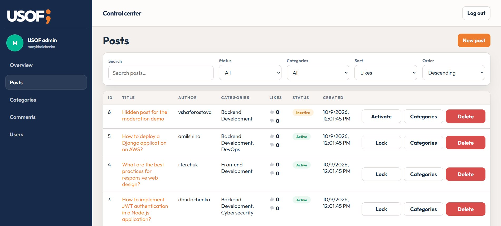
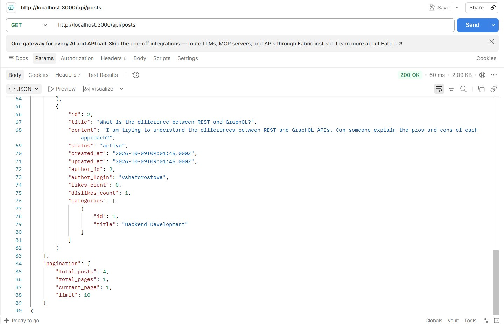

# Usof Forum

Usof Forum is a full-stack question-and-answer project for developers. It includes a REST API and administration panel, along with a React client structure for the forum interface.

## Project structure

- `backend/` — Node.js and Express API, MySQL database setup, and administration panel.
- `frontend/` — React application built with JavaScript, JSX, and Vite.

## Features

The backend provides API routes for authentication, users, posts, categories, comments, likes, favorites, subscriptions, and notifications. It also includes role-based access checks, file uploads, database initialization, sample data, and an administration panel at `/admin`.

The frontend has a shared application layout, routes for login, sign-up, the main page, profile, and notifications, and feature-based Redux Toolkit and RTK Query modules.

## Screenshots

The screenshots below show the administration panel and an example API response.






## Requirements

- Node.js 22.2 or newer
- npm
- MySQL 8.0 or newer
- Mailtrap SMTP test inbox for email confirmation and password-reset messages

## Run locally

### Install dependencies

From the repository root:

```powershell
npm install
```

### Configure and start the API

Create the backend environment file:

```powershell
Copy-Item backend/.env.example backend/.env
```

Set the MySQL connection, JWT secret, and Mailtrap values in `backend/.env`, then start the API:

```powershell
npm run start:api
```

The API defaults to `http://localhost:3000`. The administration panel is available at `http://localhost:3000/admin`. On startup, the backend initializes the database and adds sample data when the database is empty.

### Start the frontend

If you need to change the API URL, create the local frontend environment file from its example:

```powershell
Copy-Item frontend/.env.example frontend/.env.local
```

Update `VITE_API_URL` in `frontend/.env.local` as needed. This file is ignored by Git.

In a second terminal, from the repository root:

```powershell
npm run dev:web
```

Open the local address printed by Vite. The frontend uses `http://localhost:3000` as its default API base URL. Its optional setting is documented in `frontend/.env.example`.

## Configuration

The backend reads the following settings from `backend/.env`:

| Variable | Purpose |
| --- | --- |
| `PORT` | API port; defaults to `3000`. |
| `APP_URL` | Base URL used to create API email links. |
| `CLIENT_URL` | Frontend base URL used in password-reset links. |
| `DB_HOST`, `DB_USER`, `DB_PASSWORD`, `DB_NAME` | MySQL connection settings. |
| `JWT_SECRET` | Secret used to sign access tokens. |
| `MAILTRAP_HOST`, `MAILTRAP_PORT`, `MAILTRAP_USER`, `MAILTRAP_PASS` | SMTP settings for the Mailtrap test inbox. |

Keep `.env` files and their credentials private; they are excluded from Git.

## Application flow

1. The React client uses the router to display the application pages.
2. Feature API modules make HTTP requests to the Express API.
3. Express routes requests through middleware and controllers.
4. Controllers coordinate validation and backend operations; models access MySQL.
5. The API returns JSON responses to the client.

Authorization is enforced by the backend for protected API operations.

## Challenge progress

### Engage

I chose to build a developer-focused forum where users can publish posts, discuss them in comments, and organize content by category.

### Investigate

I reviewed the API resources and the frontend requirements, then organized the repository into backend and frontend applications. The root `package.json` lists the dependencies for both applications and provides shared commands for starting and building them. Dependencies are installed once from the repository root.

### Act: Basic

I set up the Express and MySQL backend, its administration panel, and an initial React application structure. I added the shared frontend layout, page routes, Redux store, and feature-level API modules. The frontend production build and backend lint checks complete successfully.
