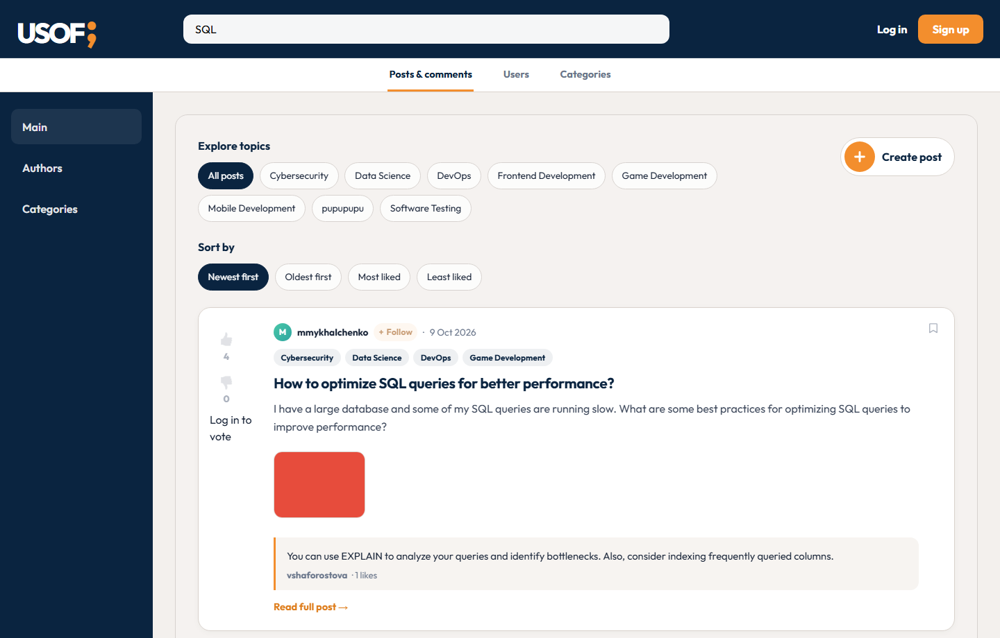
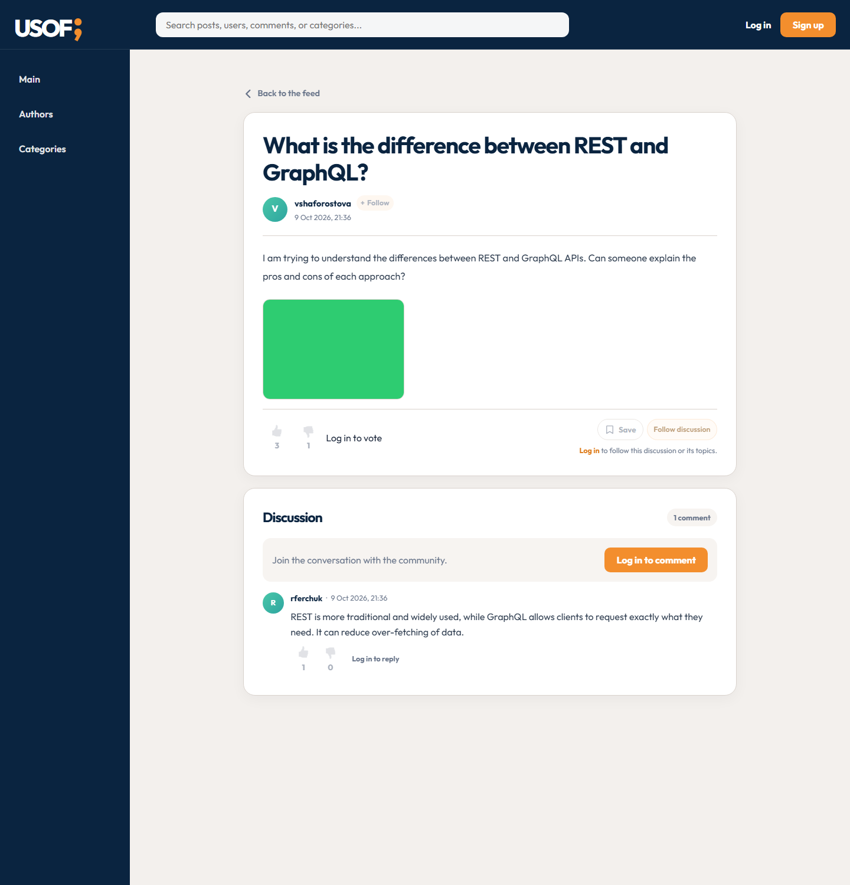
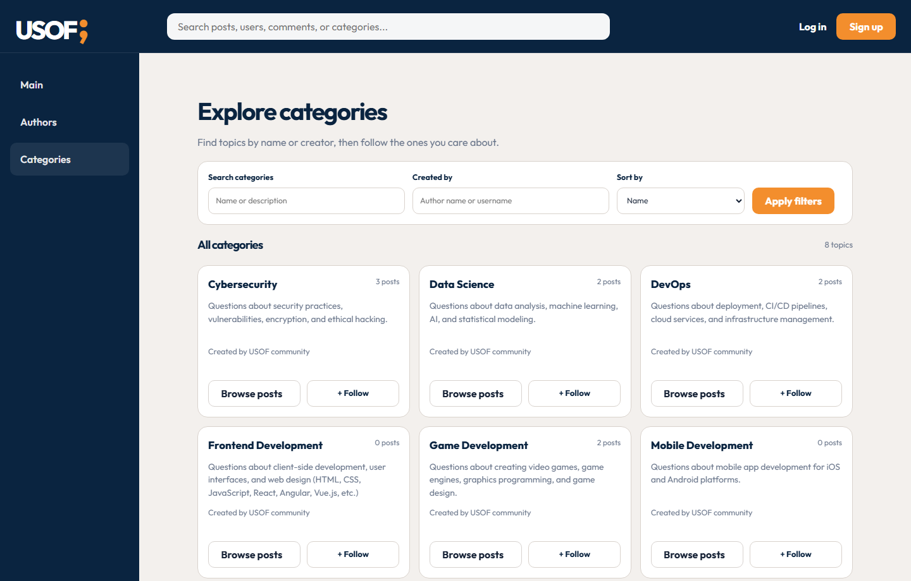
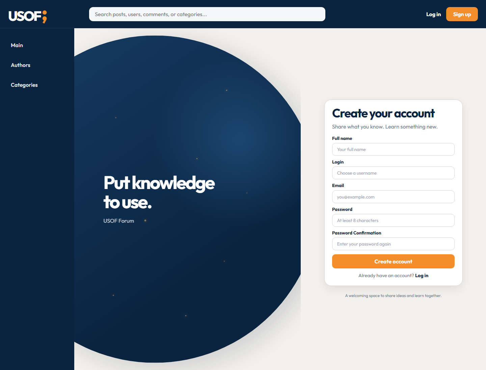

# Usof Forum

Usof Forum is a responsive question-and-answer application for developers. Members can publish and discover posts, organize discussions with categories, and communicate through threaded comments. The repository includes a React client, an Express REST API, and a MySQL database.

## Features

- Browse active posts with pagination, category filters, full-text search, and sorting by date or likes.
- View post details, attachments, ratings, comments, and nested replies.
- Register, confirm email, sign in, update profile information, and upload an avatar.
- Create, edit, categorize, activate, and deactivate posts.
- Create and manage categories; browse topics and public author profiles.
- Follow authors, categories, and post discussions; save posts and receive notifications.
- Review profile activity, including posts, comments, categories, saved items, and subscriptions.
- Moderate users, posts, categories, and comments through the administration panel.
- Use the interface on mobile, tablet, and desktop screens.

## Screenshots

### Main feed



### Post discussion



### Category discovery



### Registration



### Administration


## Technology and requirements

- Node.js 22.2 or newer and npm
- MySQL 8.0 or newer
- React, React Router, Redux Toolkit, and RTK Query
- Express 5
- Mailtrap SMTP credentials for email confirmation

All npm dependencies are installed from the repository root. The web command wrapper creates a temporary CRA manifest in `web/` when needed; do not install dependencies from that directory.

## Run locally

### 1. Install dependencies

From the repository root:

```powershell
npm install
```

### 2. Configure the environment

Create `.env` from the example:

```powershell
Copy-Item .env.example .env
```

Set the MySQL connection values and a long random `JWT_SECRET`. Configure `MAILTRAP_USER` and `MAILTRAP_PASS` to enable email confirmation. The API requires `DB_HOST`, `DB_USER`, `DB_NAME`, and `JWT_SECRET`.

### 3. Start the API

Ensure MySQL is running, then start the API from the repository root:

```powershell
npm run start:api
```

The API is available at `http://localhost:3000`. On startup, it creates or updates the database schema and loads sample data if the database has no users. The administration panel is at `http://localhost:3000/admin`.

### 4. Start the web application

In another terminal, from the repository root:

```powershell
npm run dev:web
```

Open `http://localhost:3001`. The web client uses `http://localhost:3000` as its default API URL. Change `PORT`, `WEB_PORT`, `CLIENT_URL`, and `REACT_APP_API_URL` in `.env` when using different local addresses.

## Configuration

| Variable                         | Purpose                                            | Default                    |
| -------------------------------- | -------------------------------------------------- | -------------------------- |
| `PORT`                           | API port                                           | `3000`                     |
| `WEB_PORT`                       | Web development-server port                        | `3001`                     |
| `CLIENT_URL`                     | Web origin used for CORS and links sent by the API | `http://localhost:3001`    |
| `REACT_APP_API_URL`              | API origin used by the React client                | `http://localhost:3000`    |
| `DB_HOST`                        | MySQL host                                         | `localhost`                |
| `DB_USER`                        | MySQL username                                     | `root`                     |
| `DB_PASSWORD`                    | MySQL password                                     | Empty                      |
| `DB_NAME`                        | Database name                                      | `usof_db`                  |
| `JWT_SECRET`                     | Access-token signing secret                        | Required                   |
| `MAILTRAP_HOST`                  | SMTP host                                          | `sandbox.smtp.mailtrap.io` |
| `MAILTRAP_PORT`                  | SMTP port                                          | `2525`                     |
| `MAILTRAP_USER`, `MAILTRAP_PASS` | SMTP credentials                                   | Required for email flows   |

## Reset the database

To completely recreate the configured local database and reload the schema and sample data, stop the API and run this command from the repository root:

```powershell
npm run reset-db
```

This command permanently drops the database named by `DB_NAME` and removes `api/uploads/`, including uploaded user media. It then recreates the schema, loads the seed data, and regenerates/copies seed media. Back up anything you need first. Start the API again with `npm run start:api`.

To initialize without deleting existing data, use `npm run init-db`; it does not replace existing seed records.

## Seed avatars

To customize the sample users' avatars, add these image files to `api/db/seed-assets/avatars/`:

| Seed login      | Avatar filename     |
| --------------- | ------------------- |
| `mmykhalchenko` | `mmykhalchenko.jpg` |
| `vshaforostova` | `vshaforostova.jpg` |
| `dburlachenko`  | `dburlachenko.jpg`  |
| `rferchuk`      | `rferchuk.jpg`      |
| `amilshyna`     | `amilshyna.jpg`     |
| `vkasatonov`    | `vkasatonov.jpg`    |

The seed records refer to these names under `/uploads/avatars/`. The files are copied when seed data is initialized. For a database that already contains the sample users, changing `seed.sql` will not update existing records; update those users' `profile_picture` values and copy the images into `api/uploads/avatars/`, or reset the database as described above. Resetting deletes existing database data and uploaded media.

## Seed post images

To replace the sample posts' generated placeholder images with JPGs, add any images you want to replace to `api/db/seed-assets/posts/` using these filenames:

| Post                                                          | JPG filename |
| ------------------------------------------------------------- | ------------ |
| How to optimize SQL queries for better performance?           | `seed-1.jpg` |
| What is the difference between REST and GraphQL?              | `seed-2.jpg` |
| How to implement JWT authentication in a Node.js application? | `seed-3.jpg` |
| What are the best practices for responsive web design?        | `seed-4.jpg` |
| How to deploy a Django application on AWS?                    | `seed-5.jpg` |

The seed initializer copies supplied JPGs to `api/uploads/posts/` and links them to the matching posts. Posts without a supplied JPG keep their generated PNG placeholder. This customization is applied when seed data is first loaded; for an existing database, either copy the JPG into `api/uploads/posts/` and update that post's attachment path to `/uploads/posts/seed-N.jpg`, or reset the database. Resetting permanently deletes existing database data and uploaded media.

## Application architecture

1. React Router renders the requested page inside the shared layout. Redux stores authentication state, and RTK Query manages API requests and cached data.
2. The client calls the REST API with JSON or multipart form data and renders the returned records, pagination metadata, loading states, and validation errors.
3. Express parses requests and applies CORS, authentication, and authorization middleware before dispatching to route controllers.
4. Controllers validate inputs and permissions, then use models to query or update MySQL.
5. The API returns JSON responses. RTK Query invalidates affected cache entries after mutations so views stay current.

API resources include authentication, users, posts, categories, comments, likes, favorites, subscriptions, and notifications. The server also serves uploaded media and the administration panel. Authorization is enforced by the API, not only by the client.

## Challenge documentation

- **Engage:** Identified the challenge as building a useful, responsive frontend for the USOF API, with clear interactions and feedback.
- **Investigate:** Considered the client/API boundary, React and Redux, pagination, responsive layouts, input validation, and website security.
- **Act — Basic:** Built authentication, the shared header and menu, the post feed and detail pages, profile pages, filtering, sorting, pagination, and threaded comments.
- **Act — Creative:** Added topic discovery and management, author and discussion subscriptions, saved posts, reactions, notifications, profile activity, responsive styling, and a shared footer.
- **Document:** This README records the project setup, requirements, architecture, seed-data customization, screenshots, and database reset procedure.

## Validation

Keep `.env` and its credentials private; it is excluded from Git. Build the production web client and lint the API from the repository root:

```powershell
npm run build:web
npm run lint:api
```
